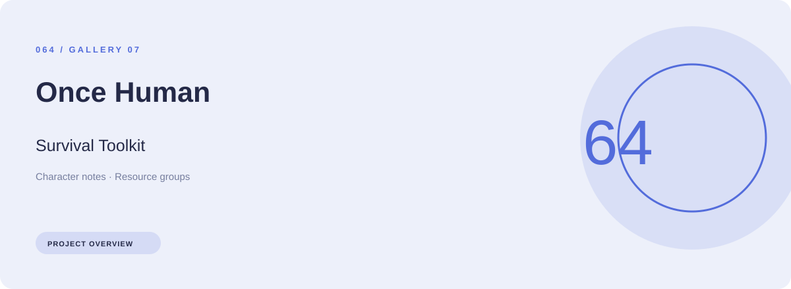
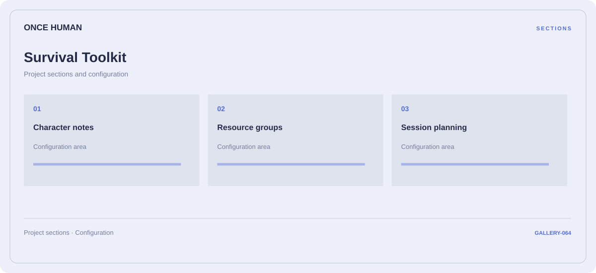

# 🛠️ Once Human Survival Toolkit

**Character notes · Resource groups · Session planning**

## ⚡ Features

A survival toolkit workspace for Once Human, built around character notes and resource groups, with session planning kept in a separate reference area.

### ⚙️ Character notes

Character-related parameters and the settings associated with the selected category.

### 🧩 Resource groups

Inventory and resource categories organized alongside their related values and notes.

### ⌨️ Session planning

Session and activity information grouped by the task or context it belongs to.

## 🖥️ Project navigation

## 📥 Download

The button and cover open the project's download page. Use the information supplied with the downloaded package for installation and release-specific requirements.

## 📚 Project documentation

- [Feature reference](docs/FEATURES.md)
- [Download information](docs/DOWNLOAD.md)
- [Project page](index.html)

---

Once Human Survival Toolkit · Program documentation and download information.
                                                                                                    